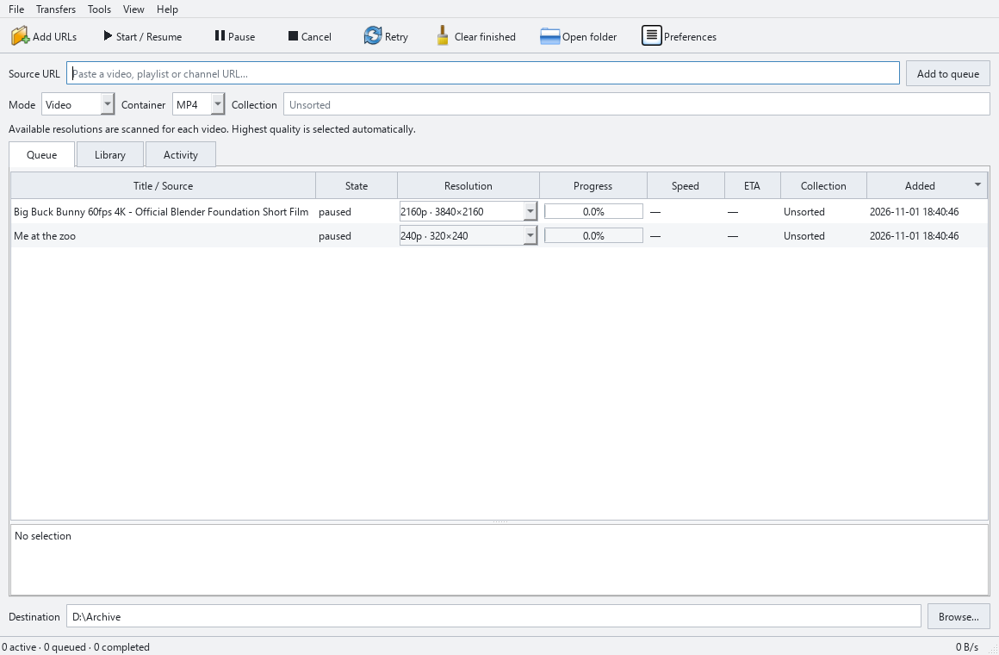

# SONATA 0.1.1 — Overture

**Serverless Optimized Native Adaptable Tape Archiver**

A standalone multimedia downloader and local archival manager for **Windows 10/11
and Linux (x86-64)**. Python, PySide6, yt-dlp, FFmpeg, and a conventional desktop interface.
Rectangular controls. Real menus. A proper table. No accounts, telemetry, or cloud backend.



[Dark theme](docs/screenshots/sonata-dark.png) · [Русский интерфейс](docs/screenshots/sonata-russian.png) · [FFmpeg window](docs/screenshots/sonata-ffmpeg.png)

## Features

- Video, audio, playlists, and channels through yt-dlp's supported extractors.
- Automatic format scanning and a resolution selector for each video, defaulting to its highest available quality, including **4320p / 8K** when offered.
- MP4 by default, with MKV and WebM alternatives; optional H.264, VP9, or AV1 source selection.
- MP3, M4A, Opus, FLAC, and WAV audio extraction through FFmpeg.
- A separate FFmpeg window for conversion, remuxing, trimming, audio extraction/normalization, metadata, subtitles, thumbnails, and FFprobe inspection.
- Subtitles, automatic captions, metadata JSON, embedded metadata, and thumbnails.
- Concurrent queue workers, per-download rate limits, retries, pause/resume, and persistent queue recovery.
- SQLite library, media-ID duplicate prevention across workers, title/URL search, and named collections.
- TAR / TAR.GZ collection export with a JSON manifest and SHA-256 checksums.
- Explicit, checksum-verified yt-dlp updates independent of the application, with a reset to the bundled version.
- Light and dark themes; English and Russian interface.
- Bundled FFmpeg, FFprobe, yt-dlp, and Deno. TAR/gzip use Python's bundled standard library.

## Run a packaged build

Download a package from [GitHub Releases](https://github.com/blindicide/SONATA/releases).
Release packages come from the verified Windows/Linux CI build. Development builds
are also available under **Actions → Test and build → Artifacts**.

**Windows portable:** extract the entire ZIP and launch `SONATA.exe`. Keep `_internal`
beside the executable. `portable.txt` stores the library/settings in `.sonata` beside
the executable. Extract to a writable folder.

**Windows installer:** launch `SONATA-0.1.1-windows-x64-setup.exe`. Installation is per-user
and does not require administrator privileges. Installed builds store data in
`%LOCALAPPDATA%\SONATA`.

**Linux portable:** extract the TAR.GZ and run `./SONATA/SONATA`.
**Debian/Ubuntu:** `sudo apt install ./sonata-archiver_0.1.1_amd64.deb`, then run `sonata`.
Linux packages bundle application runtimes and tools; a working desktop, glibc,
and standard graphics/window-system libraries are still required.

## Use

1. Choose a destination, format, and optional collection name.
2. Paste a source URL and choose **Add to queue**. Use **File → Add URLs** for a batch.
3. SONATA fetches media information and scans available formats. Click a video's **Resolution**
   cell to change its selection. Each video initially selects its highest available resolution.
4. Choose **Start / Resume** to download. Select rows to operate on those transfers; with no
   selection, transfer controls apply to the queue. Playlist/channel rows expand into individual
   scanned entries. Selecting a playlist row also controls its children. A failed item can be retried
   without restarting the collection.
5. Search completed media in **Library**, select a collection, then **Export collection**.

Preferences control filename templates, codecs, rate/retry limits, subtitles, appearance,
language, and concurrency. Preferences apply to newly added jobs; existing jobs retain
their original options. Resolution changes apply to the individual queued video. On upgrading
from 0.1.0, defaults change to MP4/highest quality for new jobs; existing queue entries keep
their saved format choices. Filenames must include `%(id)s` and `%(ext)s` to avoid collisions.

Open **Tools → FFmpeg tools…** (**Ctrl+M**) to work on an existing local file. Processing
writes a separate output and retains the input. MP4 downloads preserve metadata and chapters,
prefer AAC audio, and convert unsupported audio to AAC while copying the video. Windows
Explorer may show blank technical properties for an MKV that still contains valid streams
and tags; the FFmpeg window's **Media information** tab shows the actual file contents.

Pause stops the downloader and its post-processing children. yt-dlp retains partial files;
resuming restarts extraction and continues the transfer when the source supports it.
Queue jobs recovered after an application restart are paused until you resume them.
Completed files remain on disk when finished queue rows are cleared.

## Develop

Requires Python **3.12+** and network access for the initial tool download.

```sh
python -m venv .venv
# Windows: .venv\Scripts\activate
# Linux: source .venv/bin/activate
python -m pip install -e ".[dev]"
python scripts/fetch_tools.py
python -m sonata
```

Source dependencies are a development requirement; packaged end-user builds include
their runtimes. `fetch_tools.py` verifies every runtime against committed SHA-256 hashes.
`--refresh` explicitly updates the lock and must be reviewed before committing it.

```sh
python -m ruff check src scripts tests
python -m pytest -q
# PowerShell: $env:SONATA_INTEGRATION='1'
# Linux: SONATA_INTEGRATION=1 python -m pytest -q
python -m PyInstaller --noconfirm packaging/sonata.spec
python scripts/package.py
```

See [BUILDING](docs/BUILDING.md), [architecture](docs/ARCHITECTURE.md), and
[third-party notices](THIRD_PARTY.md). Application license: **GPL-3.0-or-later**.

## Release boundaries

- This is an initial release. Windows 8.1, 32-bit systems, ARM, and macOS are outside this release's target.
- Windows 10 22H2 or Windows 11 is the intended baseline. Linux packages are built on Ubuntu 22.04.
- Extractor availability, source access, maximum quality, subtitles, codecs, and resume support depend on the service.
  A source must offer 8K for SONATA to download it. Sources without reported dimensions use best available quality.
- Remuxing changes the container without video re-encoding. Incompatible codec/container combinations fail with the
  FFmpeg error in the row details and Activity tab. Choose MKV for broad codec compatibility.
- Duplicate detection is global to a library, by extractor/media ID. It intentionally skips a second format of the
  same media while its registered files exist. Missing registered files allow a new download.
  Generic/direct media sources use a URL hash, also appended to the filename, to distinguish unrelated servers
  with the same media basename.
- Public, accessible media is the intended workflow. No sign-in, DRM bypass, cookie management, live recording,
  or scheduled downloads are provided. Some services require credentials and cannot work anonymously.
- A duplicate already reserved by another worker is skipped; retry that row if the first worker later fails.
- An archive contains recorded completed files and sidecars. Missing or out-of-collection files abort the export
  and preserve an existing archive. File contents are not snapshotted against edits by other applications.
- No automatic network requests occur at startup. Adding a URL requests a metadata/format scan;
  media transfers require Start / Resume. Tool updates also require an explicit request.
- Binaries are unsigned. The Windows/Linux CI matrix is the source of platform build results; source code alone
  is not evidence that every operating system version has been manually tested.

Only download media you have permission to save.
